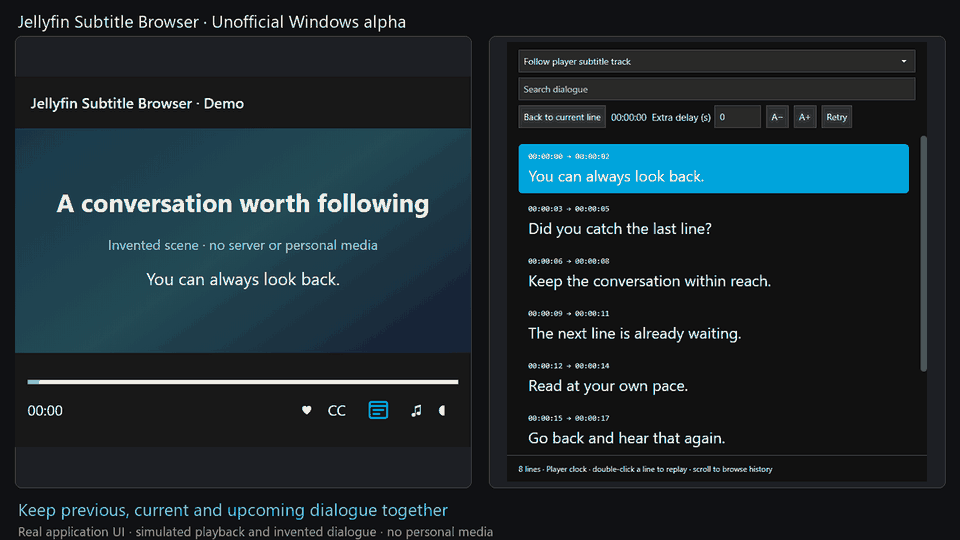

# Jellyfin Subtitle Browser

**Missed a line? Keep the conversation within reach.**

An unofficial Windows player with a separate, searchable subtitle-history window, based on Jellyfin Media Player 1.12.0.

**Windows x86 · Early alpha · Unsigned · Primarily AI-developed**

[Download the latest alpha](https://github.com/RavinduNBA/jellyfin-subtitle-browser/releases) · [Install guide](release/GETTING-STARTED.md) · [Compatibility](docs/COMPATIBILITY.md) · [Report a problem](https://github.com/RavinduNBA/jellyfin-subtitle-browser/issues/new?template=subtitle-browser-bug.yml)

## Why use it?

- See previous, current and upcoming dialogue beside the video, including on a second monitor.
- Keep the latest line highlighted through silence until the next line starts.
- Search the transcript or double-click a missed line to replay it.
- Read at your own pace; return to the current line when ready.
- Use SRT, WebVTT, ASS or SSA text subtitles.
- Keep window position, size, font size and extra delay across restarts.
- Follow Jellyfin's theme and reuse the player's session in the subtitle window.

The demo uses the real application UI with **simulated playback and invented dialogue**. It contains no personal library or copyrighted video footage.

## Try the alpha

No compiler is needed to use the release ZIP. This first **Windows x86 alpha requires the official 32-bit Jellyfin Media Player 1.12.0 runtime** installed on your PC; a 64-bit installation is not compatible with this build.

1. Follow the [install guide](release/GETTING-STARTED.md) to obtain the matching official runtime.
2. Download and extract the full release ZIP. Check its SHA-256 against the release checksums.
3. Double-click **Install.cmd**. It installs this player under your Windows account, alongside stock Jellyfin.
4. Open **Jellyfin Subtitle Browser** from Start and connect to your server normally. Its separate profile does not import or change your stock-player login.
5. Play a video with text subtitles and click the window-and-lines icon next to **CC**.

The custom executable is unsigned. Do not disable security protections to run it. If you cannot verify or do not trust the download, build from source or wait for a signed release.

## Early testers wanted

This has been tested locally, not across a broad range of PCs. Please try normal playback, subtitle-track changes, closing and reopening the transcript, and a full player restart. Tell us your release version, Windows version, subtitle format and exact steps if anything fails. [Testing checklist](docs/TESTING.md)

## Limits

No OCR for PGS/VobSub or burned-in subtitles. A server may need time to extract an embedded text track. Live streams may not supply a complete transcript. Optional joystick and HDMI-CEC integrations are disabled. Other operating systems and the current Jellyfin Desktop branch are not validated.

This is a maintained experiment on the legacy Qt client, **not an official Jellyfin feature or an accepted upstream contribution**. Read the [compatibility table](docs/COMPATIBILITY.md) before installing.

## Development, source and attribution

Most added feature code was developed with **OpenAI Codex**, iteratively tested and corrected on Windows. This disclosure concerns the fork's additions, not the original Jellyfin project. Test results do not replace independent review.

The original Git history and source credits are preserved. [Upstream client README](docs/UPSTREAM_README.md), [GPL-2.0 license](LICENSE), [build instructions](docs/BUILDING.md), and [release packaging](release/Create-Package.ps1).

Release ZIPs include our custom executable and extension, plus exact tagged source. They do not redistribute Qt/MPV runtime DLLs; installation reuses a matching local official runtime. See [storage and privacy](docs/PRIVACY.md) and [getting involved](docs/COMMUNITY.md).
